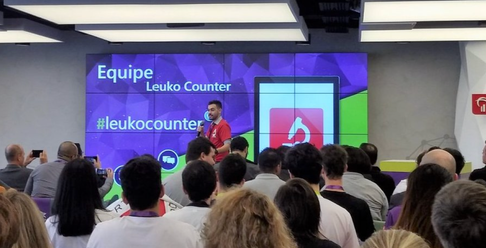
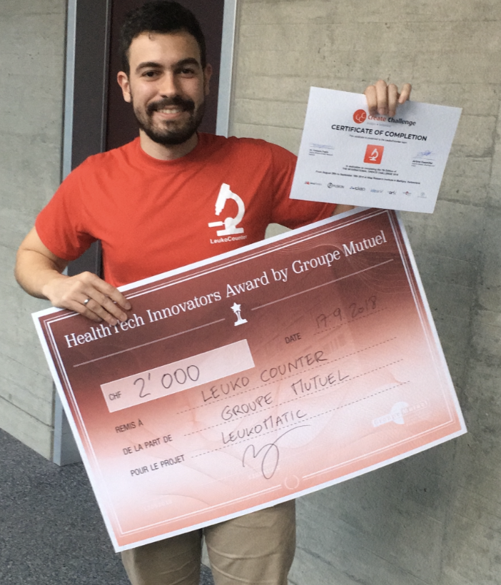
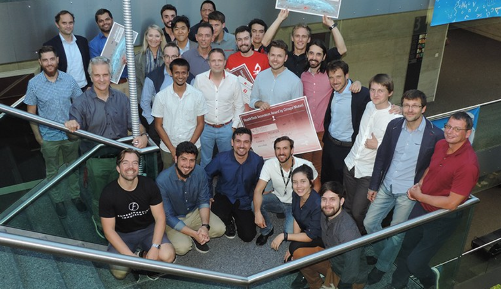
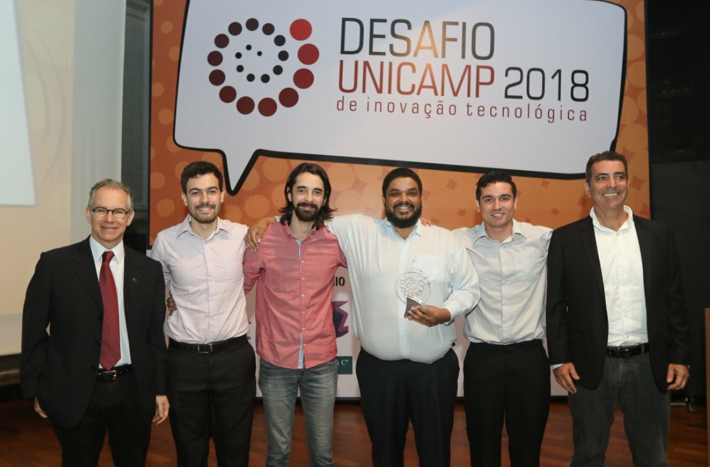
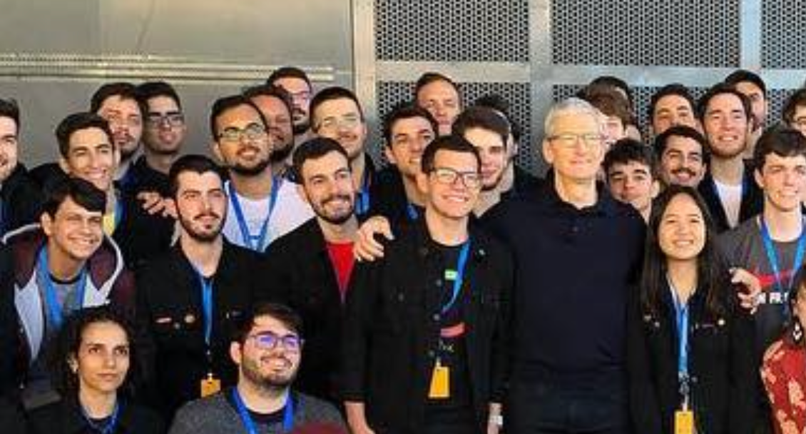
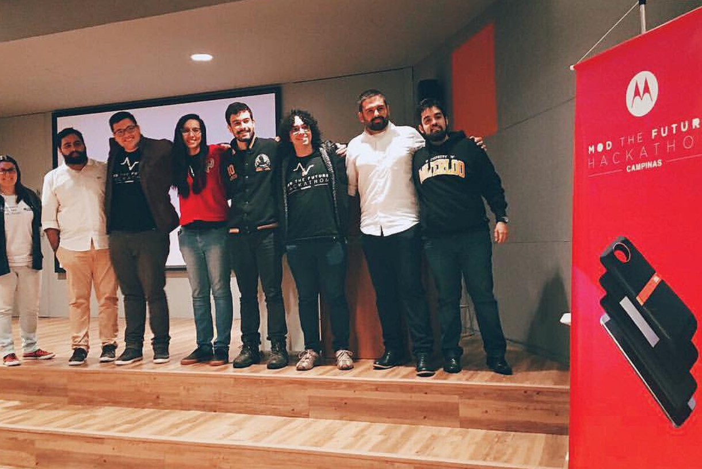

# Ricardo Felipe Ferreira

### Academic & Innovation Evidence Portfolio

Supporting documentation for selected achievements in **health technology, software, entrepreneurship, and innovation**.

 

  

---

## Overview

This repository accompanies my academic CV and brings together supporting evidence for selected awards, competitions, and projects. The PDF includes photographs, short project descriptions, and links to external publications, competition pages, and project presentations where available.

## Selected Achievements

| Achievement | Recognition |
|---|---|
| **LeukoCounter** | HealthTech project focused on assisting biomedical and healthcare professionals with white blood cell counting |
| **HealthTech Innovators Award 2018** | 2nd place — Groupe Mutuel, Switzerland |
| **International Create Challenge 2018** | Finalist / selected for an international incubation program in Switzerland |
| **Microsoft Imagine Cup LATAM 2018** | Finalist |
| **Apple WWDC 2018 Scholarship** | Winner |
| **Apple WWDC 2020 Swift Student Challenge** | Award winner |
| **Inova Unicamp Challenge 2018** | Winner by popular vote |
| **Motorola & Ford Hackathon 2017** | Winner of the Ford Challenge |

## Featured Projects

### LeukoCounter — HealthTech

LeukoCounter aimed to help biomedical and healthcare professionals count white blood cells. The project participated in innovation competitions and international programs. The evidence portfolio includes presentation and award photographs, as well as links to external coverage and project presentations.

<table>
  <tr>
    <td align="center" width="50%">
      
      LeukoCounter presentation at InovaBra
    </td>
    <td align="center" width="50%">
      
      HealthTech Innovators Award — Groupe Mutuel
    </td>
  </tr>
  <tr>
    <td align="center" colspan="2">
      
       Teams selected for the international incubation program in Switzerland
    </td>
  </tr>
</table>

### DoTrack — Inovictus Team

A project using long-range RFID technology to improve supply-chain efficiency. The portfolio documents its recognition at the 2018 Inova Unicamp Challenge.

  
   Inova Unicamp Challenge 2018

### Apple WWDC Scholarship — Educational Software

A personal software project focused on increasing young people's interest in science through primary and secondary education.

  
   WWDC Scholarship winners with Apple CEO Tim Cook

### BGen / Sync Control — Motorola & Ford Hackathon

A project exploring mobile-phone-based car access and a car-sharing business model. The team won the Ford Challenge at the Mod The Future Hackathon.

  
   Mod The Future Hackathon — Motorola / Ford Challenge

## Full Documentation

**[Open the Evidence Portfolio (PDF)](./Ricardo_Ferreira_Evidence_Portfolio.pdf)**

The PDF is the consolidated document for review or download. It contains additional competition records and external source links associated with the projects above.

## Contact

**Ricardo Felipe Ferreira** · São Paulo, Brazil  
[LinkedIn](https://www.linkedin.com/in/ricardo-felipe-ferreira/)

---

This repository is a supporting portfolio for the achievements described in my academic CV. Please consult the linked external sources in the PDF for additional context and verification.
